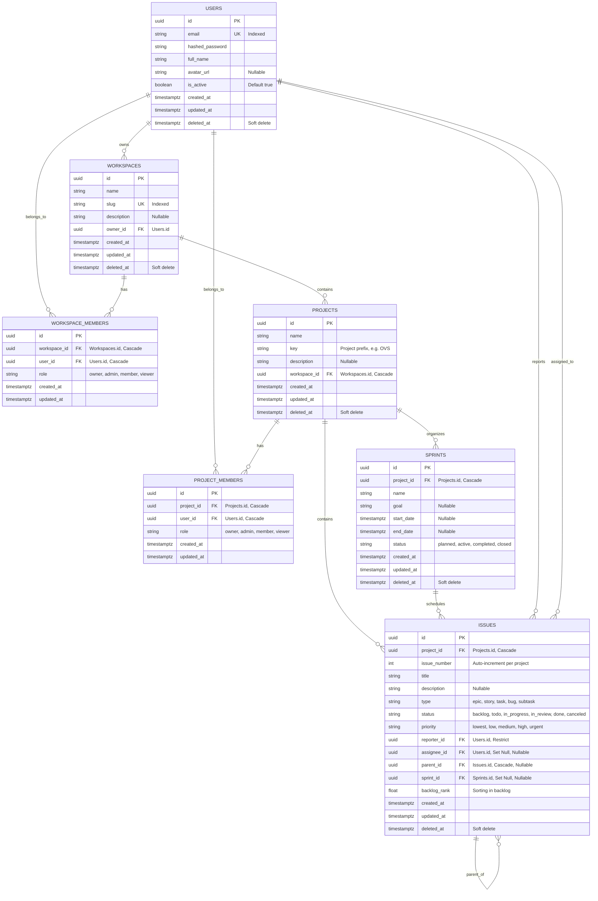

# Database Entity Relationship Diagram (ERD) — Oversee

- **Trạng thái:** Reviewed & Approved
- **Ngày hoàn thành:** 2026-11-14
- **Epic:** #13 - Database & Domain Modeling
- **Issue liên quan:** #44 - Design database ERD
- **Công nghệ lưu trữ:** PostgreSQL 16+, SQLAlchemy 2.x

---

## 1. Tổng quan kiến trúc dữ liệu (Data Architecture Overview)

Mô hình dữ liệu của **Oversee** được thiết kế để phục vụ nền tảng quản lý dự án phần mềm theo phân cấp rõ ràng:
1. **Quản trị người dùng & Không gian làm việc (Tenancy & Workspaces):**
   - Một **User** có thể sở hữu hoặc tham gia nhiều **Workspace**.
   - Mỗi **Workspace** có nhiều **WorkspaceMember** với vai trò cụ thể (`owner`, `admin`, `member`, `viewer`).
2. **Quản trị dự án (Projects & Membership):**
   - Một **Workspace** chứa nhiều **Project**.
   - Mỗi **Project** có định danh ngắn độc nhất trong workspace (`key`, ví dụ: `OVS`, `API`).
   - Mỗi **Project** quản lý danh sách **ProjectMember** với quyền hạn riêng.
3. **Quản lý công việc & Chu trình phát triển (Issues, Tasks & Sprints):**
   - Mỗi **Project** chứa nhiều **Issue** (bao gồm Epic, Story, Task, Bug, Subtask).
   - Mỗi **Issue** có số thứ tự tự tăng trong dự án (`issue_number`), tạo thành mã định danh trực quan (ví dụ: `OVS-1`, `OVS-2`).
   - **Issue** hỗ trợ phân cấp cha - con qua `parent_id` (Self-referencing Foreign Key).
   - Dự án có thể chia thành nhiều chu kỳ **Sprint**. Một Issue thuộc Backlog khi `sprint_id IS NULL`, và được xếp thứ tự thông qua `backlog_rank`.

---

## 2. Sơ đồ thực thể quan hệ (Mermaid ERD)



---

## 3. Mã nguồn DBML (Dành cho dbdiagram.io)

Để xem và chỉnh sửa trực quan trên [dbdiagram.io](https://dbdiagram.io), bạn có thể copy đoạn mã DBML dưới đây:

```dbml
// Oversee Database Schema (DBML)
// Generated for Epic #13 - Database & Domain Modeling

Enum role_type {
  owner
  admin
  member
  viewer
}

Enum issue_type {
  epic
  story
  task
  bug
  subtask
}

Enum issue_status {
  backlog
  todo
  in_progress
  in_review
  done
  canceled
}

Enum issue_priority {
  lowest
  low
  medium
  high
  urgent
}

Enum sprint_status {
  planned
  active
  completed
  closed
}

Table users {
  id uuid [pk]
  email varchar(255) [unique, not null]
  hashed_password varchar(255) [not null]
  full_name varchar(255) [not null]
  avatar_url varchar(1024)
  is_active boolean [not null, default: true]
  created_at timestamptz [not null, default: `now()`]
  updated_at timestamptz [not null, default: `now()`]
  deleted_at timestamptz

  indexes {
    email [name: 'idx_users_email']
    deleted_at [name: 'idx_users_deleted_at']
  }
}

Table workspaces {
  id uuid [pk]
  name varchar(255) [not null]
  slug varchar(100) [unique, not null]
  description text
  owner_id uuid [not null, ref: > users.id]
  created_at timestamptz [not null, default: `now()`]
  updated_at timestamptz [not null, default: `now()`]
  deleted_at timestamptz

  indexes {
    slug [name: 'idx_workspaces_slug']
    owner_id [name: 'idx_workspaces_owner_id']
  }
}

Table workspace_members {
  id uuid [pk]
  workspace_id uuid [not null, ref: > workspaces.id]
  user_id uuid [not null, ref: > users.id]
  role role_type [not null, default: 'member']
  created_at timestamptz [not null, default: `now()`]
  updated_at timestamptz [not null, default: `now()`]

  indexes {
    (workspace_id, user_id) [unique, name: 'uq_workspace_members_user']
  }
}

Table projects {
  id uuid [pk]
  name varchar(255) [not null]
  key varchar(20) [not null]
  description text
  workspace_id uuid [not null, ref: > workspaces.id]
  created_at timestamptz [not null, default: `now()`]
  updated_at timestamptz [not null, default: `now()`]
  deleted_at timestamptz

  indexes {
    (workspace_id, key) [unique, name: 'uq_projects_workspace_key']
    workspace_id [name: 'idx_projects_workspace_id']
  }
}

Table project_members {
  id uuid [pk]
  project_id uuid [not null, ref: > projects.id]
  user_id uuid [not null, ref: > users.id]
  role role_type [not null, default: 'member']
  created_at timestamptz [not null, default: `now()`]
  updated_at timestamptz [not null, default: `now()`]

  indexes {
    (project_id, user_id) [unique, name: 'uq_project_members_user']
  }
}

Table sprints {
  id uuid [pk]
  project_id uuid [not null, ref: > projects.id]
  name varchar(255) [not null]
  goal text
  start_date timestamptz
  end_date timestamptz
  status sprint_status [not null, default: 'planned']
  created_at timestamptz [not null, default: `now()`]
  updated_at timestamptz [not null, default: `now()`]
  deleted_at timestamptz

  indexes {
    project_id [name: 'idx_sprints_project_id']
    status [name: 'idx_sprints_status']
  }
}

Table issues {
  id uuid [pk]
  project_id uuid [not null, ref: > projects.id]
  issue_number integer [not null]
  title varchar(255) [not null]
  description text
  type issue_type [not null, default: 'task']
  status issue_status [not null, default: 'backlog']
  priority issue_priority [not null, default: 'medium']
  reporter_id uuid [not null, ref: > users.id]
  assignee_id uuid [ref: > users.id]
  parent_id uuid [ref: > issues.id]
  sprint_id uuid [ref: > sprints.id]
  backlog_rank double precision [not null, default: 0.0]
  created_at timestamptz [not null, default: `now()`]
  updated_at timestamptz [not null, default: `now()`]
  deleted_at timestamptz

  indexes {
    (project_id, issue_number) [unique, name: 'uq_issues_project_number']
    project_id [name: 'idx_issues_project_id']
    sprint_id [name: 'idx_issues_sprint_id']
    assignee_id [name: 'idx_issues_assignee_id']
    parent_id [name: 'idx_issues_parent_id']
    status [name: 'idx_issues_status']
    backlog_rank [name: 'idx_issues_backlog_rank']
  }
}
```

---

## 4. Từ điển dữ liệu chi tiết (Data Dictionary)

### 4.1. Bảng `users`
Lưu trữ tài khoản người dùng của hệ thống Oversee.

| Cột | Kiểu dữ liệu | Ràng buộc | Mô tả |
|---|---|---|---|
| `id` | `UUID` | PK, Not Null | Khóa chính duy nhất (UUID v4) |
| `email` | `VARCHAR(255)` | Unique, Not Null, Index | Địa chỉ email đăng nhập |
| `hashed_password` | `VARCHAR(255)` | Not Null | Mật khẩu băm (bcrypt / argon2) |
| `full_name` | `VARCHAR(255)` | Not Null | Họ và tên hiển thị |
| `avatar_url` | `VARCHAR(1024)` | Nullable | Đường dẫn ảnh đại diện |
| `is_active` | `BOOLEAN` | Not Null, Default `true` | Trạng thái kích hoạt tài khoản |
| `created_at` | `TIMESTAMPTZ` | Not Null, Default `now()` | Thời gian tạo bản ghi |
| `updated_at` | `TIMESTAMPTZ` | Not Null, Default `now()` | Thời gian cập nhật gần nhất |
| `deleted_at` | `TIMESTAMPTZ` | Nullable, Index | Thời gian xóa mềm (Soft delete) |

---

### 4.2. Bảng `workspaces`
Không gian làm việc cấp cao nhất, nhóm các dự án và thành viên tổ chức.

| Cột | Kiểu dữ liệu | Ràng buộc | Mô tả |
|---|---|---|---|
| `id` | `UUID` | PK, Not Null | Khóa chính duy nhất (UUID v4) |
| `name` | `VARCHAR(255)` | Not Null | Tên workspace (ví dụ: Team 04) |
| `slug` | `VARCHAR(100)` | Unique, Not Null, Index | Đường dẫn định danh URL (ví dụ: `team-04`) |
| `description` | `TEXT` | Nullable | Mô tả chi tiết workspace |
| `owner_id` | `UUID` | FK -> `users.id`, Restrict | Người tạo/sở hữu chính của workspace |
| `created_at` | `TIMESTAMPTZ` | Not Null, Default `now()` | Thời gian tạo |
| `updated_at` | `TIMESTAMPTZ` | Not Null, Default `now()` | Thời gian cập nhật |
| `deleted_at` | `TIMESTAMPTZ` | Nullable | Thời gian xóa mềm |

---

### 4.3. Bảng `workspace_members`
Quản lý tư cách thành viên và phân quyền trong workspace.

| Cột | Kiểu dữ liệu | Ràng buộc | Mô tả |
|---|---|---|---|
| `id` | `UUID` | PK, Not Null | Khóa chính |
| `workspace_id` | `UUID` | FK -> `workspaces.id`, Cascade | Không gian làm việc |
| `user_id` | `UUID` | FK -> `users.id`, Cascade | Người dùng tham gia |
| `role` | `VARCHAR(50)` | Not Null, Default `member` | Vai trò: `owner`, `admin`, `member`, `viewer` |
| `created_at` | `TIMESTAMPTZ` | Not Null, Default `now()` | Thời gian tham gia |
| `updated_at` | `TIMESTAMPTZ` | Not Null, Default `now()` | Thời gian cập nhật quyền |

- **Ràng buộc duy nhất:** `UNIQUE (workspace_id, user_id)` — Ngăn chặn một người dùng được thêm trùng lặp nhiều lần vào cùng một workspace.

---

### 4.4. Bảng `projects`
Dự án phần mềm thuộc về một workspace xác định.

| Cột | Kiểu dữ liệu | Ràng buộc | Mô tả |
|---|---|---|---|
| `id` | `UUID` | PK, Not Null | Khóa chính |
| `name` | `VARCHAR(255)` | Not Null | Tên dự án |
| `key` | `VARCHAR(20)` | Not Null | Mã viết tắt tiền tố issue (ví dụ: `OVS`) |
| `description` | `TEXT` | Nullable | Mô tả phạm vi dự án |
| `workspace_id` | `UUID` | FK -> `workspaces.id`, Cascade | Workspace chủ quản |
| `created_at` | `TIMESTAMPTZ` | Not Null, Default `now()` | Thời gian tạo |
| `updated_at` | `TIMESTAMPTZ` | Not Null, Default `now()` | Thời gian cập nhật |
| `deleted_at` | `TIMESTAMPTZ` | Nullable | Thời gian xóa mềm |

- **Ràng buộc duy nhất:** `UNIQUE (workspace_id, key)` — Mã key là duy nhất trong phạm vi mỗi workspace.

---

### 4.5. Bảng `project_members`
Phân quyền người dùng ở cấp độ từng dự án cụ thể.

| Cột | Kiểu dữ liệu | Ràng buộc | Mô tả |
|---|---|---|---|
| `id` | `UUID` | PK, Not Null | Khóa chính |
| `project_id` | `UUID` | FK -> `projects.id`, Cascade | Dự án |
| `user_id` | `UUID` | FK -> `users.id`, Cascade | Người dùng tham gia |
| `role` | `VARCHAR(50)` | Not Null, Default `member` | Vai trò: `owner`, `admin`, `member`, `viewer` |
| `created_at` | `TIMESTAMPTZ` | Not Null, Default `now()` | Thời gian gán vào dự án |
| `updated_at` | `TIMESTAMPTZ` | Not Null, Default `now()` | Thời gian cập nhật quyền |

- **Ràng buộc duy nhất:** `UNIQUE (project_id, user_id)` — Ngăn chặn trùng lặp thành viên trong cùng một dự án.

---

### 4.6. Bảng `sprints`
Quản lý các chu kỳ lặp phát triển (Iterative Sprints) theo mô hình Agile/Scrum.

| Cột | Kiểu dữ liệu | Ràng buộc | Mô tả |
|---|---|---|---|
| `id` | `UUID` | PK, Not Null | Khóa chính |
| `project_id` | `UUID` | FK -> `projects.id`, Cascade | Dự án chứa sprint |
| `name` | `VARCHAR(255)` | Not Null | Tên sprint (ví dụ: `Sprint 1 - Foundation`) |
| `goal` | `TEXT` | Nullable | Mục tiêu cam kết của sprint |
| `start_date` | `TIMESTAMPTZ` | Nullable | Ngày bắt đầu |
| `end_date` | `TIMESTAMPTZ` | Nullable | Ngày dự kiến kết thúc |
| `status` | `VARCHAR(50)` | Not Null, Default `planned` | Trạng thái: `planned`, `active`, `completed`, `closed` |
| `created_at` | `TIMESTAMPTZ` | Not Null, Default `now()` | Thời gian tạo |
| `updated_at` | `TIMESTAMPTZ` | Not Null, Default `now()` | Thời gian cập nhật |
| `deleted_at` | `TIMESTAMPTZ` | Nullable | Thời gian xóa mềm |

---

### 4.7. Bảng `issues`
Lưu trữ các hạng mục công việc (Issue, Task, Bug, Epic, Subtask).

| Cột | Kiểu dữ liệu | Ràng buộc | Mô tả |
|---|---|---|---|
| `id` | `UUID` | PK, Not Null | Khóa chính |
| `project_id` | `UUID` | FK -> `projects.id`, Cascade | Dự án chứa issue |
| `issue_number` | `INTEGER` | Not Null | Số thứ tự tăng dần theo dự án (1, 2, 3...) |
| `title` | `VARCHAR(255)` | Not Null | Tiêu đề công việc |
| `description` | `TEXT` | Nullable | Mô tả chi tiết, acceptance criteria |
| `type` | `VARCHAR(50)` | Not Null, Default `task` | Thể loại: `epic`, `story`, `task`, `bug`, `subtask` |
| `status` | `VARCHAR(50)` | Not Null, Default `backlog` | Trạng thái: `backlog`, `todo`, `in_progress`, `in_review`, `done`, `canceled` |
| `priority` | `VARCHAR(50)` | Not Null, Default `medium` | Độ ưu tiên: `lowest`, `low`, `medium`, `high`, `urgent` |
| `reporter_id` | `UUID` | FK -> `users.id`, Restrict | Người tạo issue |
| `assignee_id` | `UUID` | FK -> `users.id`, Set Null, Nullable | Người được giao xử lý |
| `parent_id` | `UUID` | FK -> `issues.id`, Cascade, Nullable | Issue cha (cho quan hệ phân cấp cha-con) |
| `sprint_id` | `UUID` | FK -> `sprints.id`, Set Null, Nullable | Sprint gắn kết (nếu `NULL` -> thuộc Backlog) |
| `backlog_rank` | `DOUBLE PRECISION`| Not Null, Default `0.0` | Chỉ số sắp xếp vị trí trong Backlog |
| `created_at` | `TIMESTAMPTZ` | Not Null, Default `now()` | Thời gian tạo |
| `updated_at` | `TIMESTAMPTZ` | Not Null, Default `now()` | Thời gian cập nhật |
| `deleted_at` | `TIMESTAMPTZ` | Nullable | Thời gian xóa mềm |

- **Ràng buộc duy nhất:** `UNIQUE (project_id, issue_number)` — Đảm bảo mỗi dự án có chuỗi mã issue duy nhất (kết hợp với `project.key` tạo thành `OVS-1`, `OVS-2`).
- **Khái niệm Backlog:** Khi `sprint_id IS NULL`, issue tự động nằm trong Product Backlog. Thứ tự hiển thị trong Backlog được định đoạt theo trường `backlog_rank ASC`.

---

## 5. Quy tắc toàn vẹn & Ràng buộc nghiệp vụ (Invariants & Rules)

1. **Khóa ngoại Cascade (ON DELETE):**
   - Khi xóa mềm hoặc xóa cứng Workspace: Các Project và WorkspaceMember trực thuộc bị xóa theo (`CASCADE`).
   - Khi xóa Project: Toàn bộ Sprints, Issues và ProjectMember trực thuộc bị xóa theo (`CASCADE`).
   - Khi xóa Sprint: Các Issue thuộc Sprint đó sẽ được đưa về Backlog bằng cách gán `sprint_id = NULL` (`ON DELETE SET NULL`).
   - Khi xóa User: Các Issue do User được gán xử lý (`assignee_id`) sẽ được chuyển thành `NULL` (`SET NULL`). Bản ghi người tạo (`reporter_id`) và người sở hữu (`owner_id`) bị chặn xóa (`RESTRICT`) để bảo tồn dấu vết lịch sử (audit trail).
2. **Quan hệ cha - con (Parent - Child Hierarchy):**
   - Một issue con (`parent_id`) phải cùng thuộc một `project_id` với issue cha.
   - Khi một issue cha bị xóa hoặc cập nhật, các issue con xử lý cascade phù hợp.
3. **Phân quyền đa tầng (RBAC Invariant):**
   - Người dùng phải là thành viên của Workspace mới có thể được thêm làm thành viên của Project trực thuộc.
